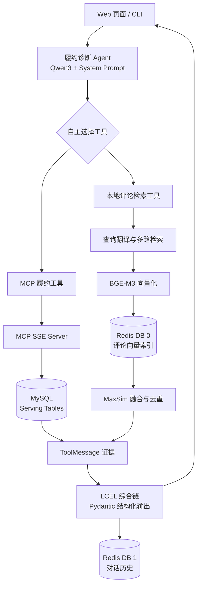

# Ecommerce Fulfillment Agent

基于 [Olist](https://www.kaggle.com/datasets/olistbr/brazilian-ecommerce) 历史电商数据的履约诊断 AI Agent。

A read-only fulfillment diagnosis agent: the model decides which tools to call, while SQL and RAG supply verifiable evidence.

本项目用于研究与学习，重点验证数据工程、RAG、Tool Calling、MCP、多工具协调、结构化输出和持久化对话记忆如何组成一条完整的 Agent 链路。它面向履约分析、异常定位和顾客声音分析，可作为后续接入生产数据时的技术参考。

它不是实时生产系统，不会退款、取消订单或联系顾客。

## 目录

- [项目能做什么](#项目能做什么)
- [系统架构](#系统架构)
- [设计原则](#设计原则)
- [技术栈](#技术栈)
- [仓库结构](#仓库结构)
- [环境要求](#环境要求)
- [快速开始](#快速开始)
- [验证脚本](#验证脚本)
- [示例问题](#示例问题)
- [指标口径](#指标口径)
- [项目边界](#项目边界)
- [数据来源](#数据来源)
- [更多文档](#更多文档)

## 项目能做什么

Agent 根据自然语言问题自主选择一个或多个业务工具，并在全部工具返回后再生成一份结构化回答：

| 能力 | 工具 | 数据来源 |
|---|---|---|
| 查询订单量、妥投率、取消率、迟到率等总体指标 | `get_fulfillment_overview` | MySQL serving 表（经 MCP） |
| 按月份、顾客州、商品类别或卖家做履约排名 | `rank_fulfillment_segments` | MySQL serving 表（经 MCP） |
| 检索迟到、破损、未收到等相关真实顾客评论 | `search_review_evidence` | Redis 评论向量索引 |

复合问题可以一次调用多个工具。模型负责理解问题和归纳结论；具体数字、排名和评论原文由工具与程序写入，避免把幻觉数字当成业务事实。

## 系统架构



数据准备链路：

```text
Olist CSV
  → MySQL raw 表
  → curated 视图（业务口径）
  → serving 物化表（查询加速）

顾客评论
  → 父子文档切块
  → BGE-M3 Embedding
  → Redis 向量索引
```

更细的模块说明见 [docs/architecture.md](docs/architecture.md)，数据层步骤见 [docs/data-pipeline.md](docs/data-pipeline.md)。

## 设计原则

1. **模型不直接算指标。** 订单量、比率、排名全部由 MySQL 聚合，Agent 只选择筛选条件。
2. **评论不是统计样本。** RAG 返回的是语义相近的定性案例，不能用来计算总体投诉率。
3. **证据以工具结果为准。** 最终回答使用 Pydantic 约束结构；程序会从 ToolMessage 回填权威 `evidence`，并校准 `answer_status`。
4. **明确能力边界。** 缺少退款、仓库、承运商、天气或实时数据时，回答应为 `partially_answered` 或 `out_of_scope`，而不是编造原因。
5. **只读。** MySQL 连接使用只读事务；MCP 工具不修改业务数据。

## 技术栈

| 层 | 选型 |
|---|---|
| 语言 | Python 3.11 |
| Agent | LangChain 1.0 / LangGraph 1.0 |
| 本地模型 | Ollama：Qwen3（决策、翻译、综合），BGE-M3（1024 维向量） |
| 结构化数据 | MySQL 8.4：raw / curated / serving |
| 向量与记忆 | Redis Stack：DB 0 评论索引，DB 1 对话历史 |
| 工具协议 | MCP（SSE）：履约概览与分组排名 |
| 界面 | Starlette + Uvicorn 本地网页，另有 CLI |

依赖安装以 `requirements.txt` 为准，并用 `constraints.txt` 锁定间接依赖版本。Starlette / Uvicorn 由 MCP 相关依赖引入。

## 仓库结构

```text
.
├── README.md
├── compose.yaml                         # MySQL 8.4 与 Redis Stack
├── requirements.txt
├── constraints.txt
├── .env.example                         # 配置模板，不含真实密码
├── data/raw/olist/                      # 放置 Olist CSV（本仓库不收录数据文件）
├── database/migrations/                 # 建表、curated 视图、serving 物化、索引
├── docs/                                # 架构与数据链路说明
└── src/ecommerce_fulfillment_agent/
    ├── config.py                        # 从项目根目录 .env 加载配置
    ├── agent/                           # 总协调 Agent、综合链、记忆、CLI、Web
    ├── agent_tools/review_evidence.py   # 本地评论检索 Tool
    ├── data_pipeline/                   # CSV 校验、导入、画像、向量索引
    ├── infrastructure/                  # MySQL / Redis 连接
    ├── mcp_server/                      # 两个履约分析 MCP 工具
    ├── rag/                             # 切块、Embedding、翻译、多路检索
    └── services/                        # 与 MCP 同口径的本地查询（便于单独验证 SQL）
```

## 环境要求

- Python 3.11
- Docker Desktop（用于 MySQL 与 Redis）
- [Ollama](https://ollama.com/)，并准备 `qwen3:14b` 与 `bge-m3`
- 建议预留足够内存：14B 对话模型与全量评论向量化都较吃资源
- 当前运行说明以 Windows PowerShell 为主；Linux / macOS 将 `PYTHONPATH` 与路径分隔符按本机习惯替换即可
- `constraints.txt` 含 `pywin32`，非 Windows 环境安装时如遇该包失败，可去掉该行后再安装

原始 CSV 体积较大，且 `.gitignore` 已排除数据文件。克隆仓库后需自行下载数据集，放到 `data/raw/olist/`。

## 快速开始

以下命令均在**项目根目录**执行。

### 1. 配置与依赖

```powershell
Copy-Item .env.example .env
python -m venv .venv
.\.venv\Scripts\Activate.ps1
python -m pip install -r requirements.txt -c constraints.txt
docker compose up -d
```

编辑 `.env`，把示例密码改成自己的值。不要把 `.env` 提交到 Git。

安装并拉取模型：

```powershell
ollama pull qwen3:14b
ollama pull bge-m3
```

本仓库把 `src/` 作为包根目录。每次打开新的终端后执行：

```powershell
$env:PYTHONPATH = (Resolve-Path .\src).Path
```

Linux / macOS：

```bash
export PYTHONPATH="$PWD/src"
```

### 2. 准备 Olist CSV

本仓库不含原始数据，需自行下载。数据集页面（需免费 Kaggle 账号，登录后点 **Download**）：

```text
https://www.kaggle.com/datasets/olistbr/brazilian-ecommerce
```

下载得到的压缩包一般名为 `brazilian-ecommerce.zip`。解压后把下面 9 个 CSV **直接**放到：

```text
data/raw/olist/
```

不要多套一层文件夹，也不要改文件名。压缩包可以留在同一目录，`.gitignore` 不会把它提交到 Git。

更细的放置说明见 [data/raw/olist/README.md](data/raw/olist/README.md)。完整来源、许可和引用见文末 [数据来源](#数据来源)。

| 文件 | 期望行数（不含表头） |
|---|---|
| `olist_customers_dataset.csv` | 99,441 |
| `olist_orders_dataset.csv` | 99,441 |
| `olist_order_items_dataset.csv` | 112,650 |
| `olist_order_payments_dataset.csv` | 103,886 |
| `olist_order_reviews_dataset.csv` | 99,224 |
| `olist_products_dataset.csv` | 32,951 |
| `olist_sellers_dataset.csv` | 3,095 |
| `product_category_name_translation.csv` | 71 |
| `olist_geolocation_dataset.csv` | 1,000,163 |

可先校验 CSV 是否完整：

```powershell
python -m ecommerce_fulfillment_agent.data_pipeline.validate_raw
```

### 3. 初始化 MySQL 并导入

等待 `docker compose` 中 MySQL 健康检查通过后，按顺序执行迁移。PowerShell 示例（把密码换成 `.env` 里的 `MYSQL_PASSWORD`）：

```powershell
Get-Content .\database\migrations\001_create_raw_tables.sql -Raw |
  docker exec -i ecommerce-fulfillment-mysql mysql -uecommerce_app "-pyour_mysql_app_password" ecommerce_fulfillment
```

然后导入 CSV：

```powershell
python -m ecommerce_fulfillment_agent.data_pipeline.load_raw
```

继续执行：

```text
database/migrations/002_create_curated_views.sql
database/migrations/003_materialize_curated_tables.sql
database/migrations/004_add_order_fulfillment_indexes.sql
```

导入后可检查 serving 层契约：

```powershell
python -m ecommerce_fulfillment_agent.data_pipeline.validate_serving
```

### 4. 构建评论向量索引

```powershell
python -m ecommerce_fulfillment_agent.data_pipeline.index_review_chunks
```

全量索引约 40,958 条有文本的父评论、53,943 个向量切块，耗时取决于本机 Ollama 与磁盘。脚本支持把 `PARENT_DOCUMENT_LIMIT` 改成较小整数做抽样试跑。

### 5. 启动 MCP 与对话入口

先启动履约分析 MCP（默认 SSE：`http://127.0.0.1:28080/sse`）：

```powershell
python -m ecommerce_fulfillment_agent.mcp_server.fulfillment_server
```

另开终端，设置同样的 `PYTHONPATH` 后启动网页（`http://127.0.0.1:28081`）：

```powershell
python -m ecommerce_fulfillment_agent.agent.web_app
```

或使用命令行：

```powershell
python -m ecommerce_fulfillment_agent.agent.cli
```

网页与 CLI 都依赖正在运行的 MCP 服务、MySQL、Redis 和 Ollama。

## 验证脚本

这些脚本用于检查数据、工具和总协调链路，不是 pytest 套件。需要对应服务已启动。

| 脚本 | 作用 |
|---|---|
| `data_pipeline.validate_raw` | 检查 CSV 行数与表头 |
| `data_pipeline.validate_serving` | 检查 serving 表完整性与口径约束 |
| `data_pipeline.profile_raw` / `profile_rag_corpus` / `profile_chunking` | 数据画像，辅助切块与检索设计 |
| `agent.mcp_client` | 发现 MCP 工具并实际调用概览、排名 |
| `agent_tools.review_evidence` | 本地评论检索工具自检 |
| `agent.memory` | Redis 会话读写与隔离 |
| `agent.validate_coordinator` | 复合问题：三个工具 + 结构化综合 |

```powershell
python -m ecommerce_fulfillment_agent.agent.validate_coordinator
```

## 示例问题

- 2018 年上半年的订单量、妥投率、取消率和迟到率是多少？
- 订单量至少 100 单的顾客州中，哪些州迟到率最高？
- 哪些商品类别最容易错过发货截止时间？
- 找出 5 条与商品破损或包装损坏有关的真实评论。
- 综合总体迟到率、州排名和迟到评论，完成一份履约诊断。
- 退款率是多少？（应被识别为超出数据范围）

## 指标口径

- 统计默认按订单**购买日期**筛选，起止日期均包含在内。
- **妥投率 / 取消率**分母为筛选范围内的订单数。
- **迟到**：实际送达日的日历日期晚于预计送达日。
- **迟到率**分母仅为可计算配送指标的订单（已妥投，且具备完整、时序合理的送达与预计送达日期）。没有数据不等于指标为零。
- **发货截止时间错过**与最终配送迟到是不同指标，不能互相替代。
- 用户未指定日期时，工具默认使用数据集完整范围：2016-09-04 至 2018-10-17。

## 项目边界

当前只能基于 Olist 公开历史订单与评论做分析。数据中不包含：

- 退款记录与退款原因
- 仓库、库存、拣货与补货
- 物流承运商名称与运输轨迹
- 天气或其他不可抗力
- 实时订单或未来结果

因此不能判定承运商/仓库责任，不能预测未来订单，也不能执行业务操作。评论检索结果不能代表全部顾客。

## 数据来源

| 项 | 内容 |
|---|---|
| 数据集名称 | Brazilian E-Commerce Public Dataset by Olist |
| 发布方 | Olist（巴西电商平台） |
| 下载页面 | https://www.kaggle.com/datasets/olistbr/brazilian-ecommerce |
| 文件列表页 | https://www.kaggle.com/datasets/olistbr/brazilian-ecommerce/data |
| 许可 | [CC BY-NC-SA 4.0](https://creativecommons.org/licenses/by-nc-sa/4.0/)（以 Kaggle 页面当时标注为准） |
| 数据时间范围 | 订单购买日期约 2016-09-04 至 2018-10-17 |
| 本仓库 | **不包含** CSV / zip；克隆后需按上面地址自行下载 |

操作摘要：打开下载页面 → 登录 Kaggle → Download → 解压 zip → 将 9 个 `*.csv` 放到 `data/raw/olist/` → 运行 `validate_raw`。

也可在已配置 [Kaggle API](https://github.com/Kaggle/kaggle-api) 的环境下下载到该目录：

```powershell
kaggle datasets download -d olistbr/brazilian-ecommerce -p data/raw/olist
```

然后把 zip 解压到同一个 `data/raw/olist/` 目录。

引用示例（按发布方要求使用时请核对该页最新说明）：

```text
Olist. Brazilian E-Commerce Public Dataset by Olist.
https://www.kaggle.com/datasets/olistbr/brazilian-ecommerce
```

本仓库代码仅供学习与研究。请勿将示例配置中的密码用于真实环境。

## 更多文档

- [系统架构、Agent 流程与回答结构](docs/architecture.md)
- [数据分层、迁移顺序与 RAG 索引](docs/data-pipeline.md)
- [Olist CSV 放置说明](data/raw/olist/README.md)

本项目的价值不在于让大模型直接读取全部数据，而在于让模型负责理解、决策和归纳，把统计计算、数据检索和证据边界交给可验证的工具与数据层。
